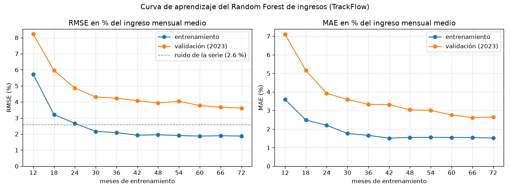

# Reporte de evaluación: pronóstico de ingresos mensuales de TrackFlow

Evaluación técnica del Random Forest de `scripts/train_sales_forecast.py` (PR #13) antes de su paso a staging. Lo que se evalúa es el modelo tal cual está en `main`: 500 árboles, `min_samples_leaf=2`, `random_state=42`, los ocho features de `MODEL_FEATURES` y target `revenue_eur / rolling_mean_12`. En ese proyecto no se tunearon hiperparámetros: se dejaron casi por defecto, como se justifica en el script.

Todo lo de este reporte usa solo los años de entrenamiento (2016-2023). Los años de prueba (2024-2025) no intervienen ni en el diagnóstico ni en la elección de la acción correctiva.

## Respuestas al ticket

1. **¿Underfitting, overfitting o bien ajustado?** **Overfitting moderado.** El error de entrenamiento (RMSE 2,06 % del ingreso medio) está por debajo del ruido propio de la serie (2,58 %), así que el modelo memoriza parte de ese ruido. El de validación (4,34 %) se queda claramente por encima, y la brecha entre ambos no se cierra al llegar a los 72 meses de entrenamiento. No es underfitting: el modelo sí captura el patrón, porque su error de entrenamiento está por debajo del ruido y no por encima.
2. **¿Qué tan estable es?** Razonablemente estable. En los cinco años de validación el RMSE va del 3,58 % al 5,25 %: **4,34 % ± 0,74** (media ± desviación estándar). En euros, 45.469 ± 5.112 EUR al mes.
3. **Acción correctiva:** **quitar los features de corto plazo `lag_1_rel`, `lag_2_rel`, `lag_3_rel` y `rolling_std_12_rel`** y mantener `lag_12_rel`, `rolling_mean_3_rel`, `month_sin` y `month_cos`. En validación cruzada, el RMSE de validación baja a **3,88 % ± 0,43**, la brecha con entrenamiento pasa de 2,3 a 1,6 puntos y la dispersión entre años casi se reduce a la mitad. Regularizar los árboles (hojas más grandes, menos profundidad, menos features por corte) no lo arregla. Detalle en [Acción correctiva](#acción-correctiva).

## Cómo se ha evaluado

- **Validación cruzada temporal:** `TimeSeriesSplit(n_splits=5, test_size=12)` sobre los 84 meses útiles de entrenamiento (2017-2023). Cada fold entrena con todos los meses anteriores y valida el año natural siguiente completo, con su pico de noviembre-diciembre y su valle de febrero. Los años validados son 2019, 2020, 2021, 2022 y 2023.
- **Sin barajar:** los folds salen de `time_series_folds` (`data/process/sales_forecast_features.py`). El script comprueba que coinciden índice a índice con los de `TimeSeriesSplit`, que los índices son consecutivos y crecientes y que todo el entrenamiento de un fold es anterior a su validación. `tests/pipelines/test_sales_forecast_cv.py` lo vuelve a comprobar, junto con que ningún índice de un fold posterior aparece antes que uno anterior.
- **Sin fuga de lag/rolling entre folds:** los features se calculan sobre la serie completa, pero solo con meses anteriores (`shift(1)` antes de `rolling`). Para demostrarlo, el script y el test borran todos los ingresos desde el primer mes de cada fold de validación, recalculan los features y verifican que las filas de entrenamiento de ese fold quedan idénticas. Las filas de validación sí usan meses del periodo de entrenamiento (por ejemplo, el lag de 12 meses), igual que en producción. Además, se metieron dos fallos a propósito, un fold que solapa y un rolling que mira al futuro, y los tests fallaron en ambos casos.
- **Curva de aprendizaje:** validación fija en 2023, el último año de entrenamiento. Cada punto entrena con los `n` meses inmediatamente anteriores, de 12 a 72.
- **Referencia de ruido:** desviación típica del residuo de la descomposición multiplicativa de 2016-2023, la parte del ingreso mensual que ni la tendencia ni la estacionalidad explican: **2,58 %**.

Se reproduce con:

```sh
uv run scripts/evaluate_sales_forecast.py
uv run --project data/pipelines python -m pytest tests/pipelines/test_sales_forecast_cv.py
```

El detalle numérico está en `data/eval/sales_forecast/evaluation_cv.json`.

## Resultados por fold

| Fold | Entrena | Valida | MAE train | RMSE train | MAE validación | RMSE validación |
|---|---|---|---|---|---|---|
| 1 | 2017-2018 (24 meses) | 2019 | 17.008 EUR | 20.755 EUR (2,40 %) | 37.118 EUR (3,89 %) | 46.124 EUR (4,83 %) |
| 2 | 2017-2019 (36) | 2020 | 15.244 EUR | 19.033 EUR (2,13 %) | 40.844 EUR (4,16 %) | 51.612 EUR (5,25 %) |
| 3 | 2017-2020 (48) | 2021 | 15.509 EUR | 18.920 EUR (2,06 %) | 32.756 EUR (3,09 %) | 38.040 EUR (3,58 %) |
| 4 | 2017-2021 (60) | 2022 | 14.497 EUR | 17.566 EUR (1,86 %) | 42.501 EUR (3,89 %) | 48.127 EUR (4,41 %) |
| 5 | 2017-2022 (72) | 2023 | 14.688 EUR | 18.191 EUR (1,88 %) | 31.673 EUR (2,64 %) | 43.441 EUR (3,62 %) |
| **Media ± desv.** | | | **15.389 ± 993 EUR** (1,68 ± 0,18 %) | **18.893 ± 1.198 EUR** (2,06 ± 0,22 %) | **36.978 ± 4.781 EUR** (3,53 ± 0,64 %) | **45.469 ± 5.112 EUR** (4,34 ± 0,74 %) |

Los porcentajes son sobre el ingreso mensual medio del periodo correspondiente.

## Curva de aprendizaje



| Meses de entrenamiento | 12 | 24 | 36 | 48 | 60 | 72 |
|---|---|---|---|---|---|---|
| RMSE entrenamiento | 5,72 % | 2,67 % | 2,09 % | 1,96 % | 1,88 % | 1,88 % |
| RMSE validación (2023) | 8,22 % | 4,87 % | 4,23 % | 3,93 % | 3,77 % | 3,62 % |

- **Entrenamiento:** el error baja por debajo del ruido de la serie a partir de 30 meses y se queda en ~1,9 %. El modelo ajusta los meses de entrenamiento mejor de lo que permite el ruido, señal de que memoriza parte de él.
- **Validación:** el error baja deprisa hasta unos 36 meses y después solo ~0,6 puntos en otros 36. La curva se está aplanando.
- **Brecha:** de 2,5 puntos con 12 meses a 1,7 con 72. Se estrecha despacio y no se cierra.

Ese es el patrón de «brecha amplia y persistente con entrenamiento bajo»: overfitting. No es underfitting, porque las curvas no convergen en un error alto. Tampoco es un buen ajuste, porque no convergen en un error bajo y cercano. La brecha es moderada: la validación queda en 3,6–4,3 %, lejos del 7,2 % de repetir el mismo mes del año anterior que se midió en el proyecto previo.

## Métrica principal: RMSE, con MAE para comunicar

Las dos se calculan para entrenamiento y validación (tabla de folds). Las dos están en euros, así que Finanzas puede leerlas directamente:

- **MAE**, el error medio absoluto: «de media nos equivocamos en unos 37.000 EUR al mes». Trata igual diez errores pequeños que uno grande.
- **RMSE** eleva los errores al cuadrado antes de promediar, así que un mes con un fallo grande pesa mucho más. En validación, RMSE/MAE ≈ 1,23: hay meses con fallos bastante mayores que la media, por ejemplo +106.670 EUR en noviembre de 2019 o −96.558 EUR en marzo de 2020.

**Elegimos RMSE como métrica principal** porque refleja mejor lo que le cuesta a TrackFlow equivocarse. Esto es una deducción nuestra a partir de la documentación de la empresa, no algo que el BRIEFING diga de forma explícita:

- El BRIEFING de sales forecasting dice que el pronóstico sirve para anticipar los picos y valles de volumen que hoy Ana (Almacén) y Carlos (Carriers) prevén a mano. Lo que se decide con él es capacidad de almacén y de transportistas.
- El documento de SLA de TrackFlow (`trackflow-sla-delivery`, contextos generales del syllabus) compromete un 90 % de entregas a tiempo al mes por país. Si un país cae por debajo dos meses seguidos, el cliente tiene derecho a una compensación del 5 % de la tarifa mensual de ese país.
- **Conclusión:** un error pequeño se absorbe con la holgura normal de la operación. Un mes con un fallo grande, sobre todo por **subestimar** el volumen, deja al almacén y a los transportistas sin capacidad, y eso puede costar el SLA y la compensación. Sobreestimar cuesta capacidad ociosa, sin una penalización contractual documentada. RMSE es la métrica que castiga esos meses de fallo grande; el MAE los diluye en la media.

Para vigilar la asimetría se registra también qué parte de los meses se subestima (`under_share` en el JSON). Hoy el error es simétrico: el modelo se queda corto en el 48 % ± 25 % de los meses de validación, con una subestimación media de 33.337 EUR. No hay un sesgo sistemático hacia quedarse corto que exija penalizar más ese lado. Los fallos grandes tampoco se concentran en noviembre-diciembre: el RMSE de esos meses es de 43.333 EUR, frente a 46.157 EUR en el resto.

## Acción correctiva

Variantes comparadas con la misma validación cruzada (`evaluation_cv.json` → `candidates`):

| Variante | RMSE train | RMSE validación (media ± desv.) | MAE validación |
|---|---|---|---|
| Modelo actual | 2,06 % | 4,34 ± 0,74 % | 3,53 ± 0,64 % |
| `min_samples_leaf=5` | 4,09 % | 5,33 ± 1,75 % | 4,38 ± 1,40 % |
| `min_samples_leaf=10` | 7,27 % | 8,07 ± 2,49 % | 6,51 ± 1,72 % |
| `max_depth=3` | 2,93 % | 4,31 ± 0,76 % | 3,49 ± 0,61 % |
| `max_features=0.5` | 2,39 % | 4,49 ± 0,85 % | 3,79 ± 0,84 % |
| **Sin `lag_1/2/3_rel` ni `rolling_std_12_rel`** | **2,23 %** | **3,88 ± 0,43 %** | **3,21 ± 0,43 %** |
| Solo `lag_12_rel` y mes | 2,35 % | 3,86 ± 0,58 % | 3,17 ± 0,43 % |

**Propuesta:** quitar del modelo `lag_1_rel`, `lag_2_rel`, `lag_3_rel` y `rolling_std_12_rel`.

**Causa raíz.** El patrón de esta serie es la estacionalidad anual sobre una tendencia. Los ingresos de los últimos 1–3 meses, relativos al nivel, contienen sobre todo el ruido mensual del 2,6 %. Con solo 84 filas, los árboles encuentran cortes en esos features que separan bien los meses de entrenamiento pero no se repiten en años nuevos: eso es lo que lleva el error de entrenamiento por debajo del ruido. Ya en el modelo actual, `lag_12_rel` concentra el 89 % de la importancia y los lags cortos suman menos del 6 %: aportan poca señal y bastante capacidad de memorizar. `rolling_std_12_rel` es además el feature con más deriva entre entrenamiento y prueba (PSI 0,52 en el proyecto anterior).

**Por qué esta acción y no otra:**

- **Regularizar los árboles no ataca la causa.** Con hojas más grandes, el modelo pierde también la estacionalidad y la validación empeora (5,3 % y 8,1 %): pasa de overfitting a underfitting. `max_depth=3` y `max_features=0.5` apenas cambian nada.
- **Quitar los features de ruido sí.** El error de entrenamiento sube de 2,06 % a 2,23 %, más cerca del ruido real, la validación baja a 3,88 %, la brecha pasa de 2,28 a 1,65 puntos y la desviación entre años cae de 0,74 a 0,43.
- **Más datos no es una opción práctica.** La curva de validación ya se aplana (−0,6 puntos entre 36 y 72 meses) y el dataset tiene los 10 años que existen.
- **Por qué no quedarse solo con `lag_12_rel` y el mes,** que da una media casi igual: varía más entre años (± 0,58) y renuncia a `rolling_mean_3_rel`, que es la única señal de si el año se está acelerando o frenando.

**Siguiente paso:** aplicar el cambio en un PR aparte, repetir esta validación cruzada y medirlo una sola vez sobre 2024-2025. La decisión se ha tomado sin mirar esos años para que esa medición siga siendo honesta.

## Límites

- Cinco folds de un año: la desviación estándar sale de cinco valores y la diferencia entre 3,88 % y 3,86 % no es significativa. La de 4,34 % a 3,88 % es consistente: la variante mejora en todos los folds menos en 2021 (3,78 % frente a 3,58 %).
- El error de entrenamiento de un Random Forest se mide sobre filas que los árboles han visto, así que es optimista por construcción. Por eso el diagnóstico se apoya también en compararlo con el ruido de la serie, no solo en la brecha.
- La asimetría de costes es una deducción a partir del SLA, no un dato del BRIEFING. Si Finanzas u Operaciones dan un coste por euro de error en cada dirección, convendría usar una pérdida asimétrica.
