# Pipeline de desempeño de negocio — Diseño (Parte 1 de 3)

> **Estado:** implementado en la Parte 2 (`data/pipelines/pipeline.py`, esquema `reporting` y endpoints `/reporting`) y refactorizado en subflows en la Parte 3, con tests unitarios en `tests/pipelines/` y el dashboard `/reporting` del backoffice. La §9 resume cómo se ejecuta, con qué frecuencia y qué cambió en la Parte 2; la §10, los subflows, los tests y el dashboard.

> **Bloqueo: falta el `company-BRIEFING.md` de data pipelines.** No está en el repositorio ni en ninguna rama, igual que el BRIEFING de telemetría en las fases anteriores. Los datos que debería fijar ese documento se han tomado de `CONTEXT.md` y del código, y están todos en la tabla siguiente. Cuando tengamos el BRIEFING hay que sustituirlos aquí y en el resto del documento.

| Dato que fija el BRIEFING | Valor usado en este diseño | Origen |
|---|---|---|
| Entregable de negocio | Informe ejecutivo semanal, generado los lunes a las 07:00 | `CONTEXT.md`, Dirección Ejecutiva |
| Audiencia | Dirección ejecutiva (CEO). `CONTEXT.md` lo nombra como Thomas Harry y como Daniel Espinoza; mantenemos la contradicción sin resolverla | `CONTEXT.md` |
| Frecuencia | Semanal para el informe; los datos se calculan a diario | `CONTEXT.md` y propuesta propia |
| KPIs a medir | Volumen de envíos, tasa de entrega a tiempo, coste operativo (solo transporte), tasa de devoluciones y satisfacción del cliente, comparados por país | `CONTEXT.md` y `ExecutiveDashboard` en `services/api/app/schemas/dashboard.py` |
| Agregación requerida | Día UTC × país (× transportista o moneda cuando aplica), con agregado semanal ISO al consultar | Propuesta propia |
| Tabla de destino | `reporting.executive_kpis_daily` (**nombre provisional**) | Propuesta propia; hay que usar el nombre exacto de la sección «Destination table» |
| Métricas obligatorias de telemetría | Eventos núcleo candidatos (Núcleo\*) del plan de telemetría | [`docs/telemetry/telemetry-plan.md`](../../docs/telemetry/telemetry-plan.md) §2.2 y §3 |
| Campos aditivos de payload | Ninguno: `shipment_delivered` ya lleva `shipping_cost`, `currency` y `weight_kg` | `docs/telemetry/event-schemas.json` |

---

## 1. Estado actual

### 1.1 Qué telemetría capturamos

El contrato [`docs/telemetry/event-schemas.json`](../../docs/telemetry/event-schemas.json) define 39 tipos de evento con un sobre común de 8 campos (`eventId`, `timestamp`, `sessionId`, `userId`, `event_type`, `schemaVersion` = `1.0.0`, `requestId`, `properties`) y una allowlist cerrada de propiedades por evento.

Hoy solo se emiten cuatro:

| Evento | Origen | Cuándo llega |
|---|---|---|
| `page_viewed`, `web_vitals_measured`, `frontend_error_occurred` | Backoffice (`uis/backoffice/src/services/telemetry.ts`) | Lotes cada 30 s o cada 20 eventos, 3 reintentos con los mismos `eventId` y `sendBeacon` al ocultar la página. Cola en memoria, sin buffer persistente |
| `inventory_movement_recorded` | Backend, `POST /inventory/movements` (solo demo local) | En una `BackgroundTask` tras confirmar el movimiento. Si el almacén de telemetría falla se descarta sin reintento |

Los eventos núcleo que alimentarían los KPIs ejecutivos **todavía no se emiten**: `shipment_created` y `shipment_delivered` son futuros (no hay alta de envíos ni agregador de tracking), `order_created` y `return_requested` dependen de endpoints stub 501, y `customer_satisfaction_submitted` es futuro y sin método de medición definido.

### 1.2 Dónde se almacena

`public.telemetry_events` en Supabase (Postgres 17), solo en local. Migraciones en `services/api/supabase/migrations/`; detalle en [`docs/telemetry/storage.md`](../../docs/telemetry/storage.md).

- Columnas: `event_id` (uuid, PK), `event_type`, `timestamp` (timestamptz, hora del hecho en origen), `service`, `session_id`, `user_id`, `request_id` y `tags` (jsonb con las `properties` del evento más `schemaVersion`).
- Inmutable: los triggers bloquean UPDATE, DELETE y TRUNCATE. La ingesta usa `insert … on conflict do nothing`, así que un `eventId` repetido no se guarda dos veces.
- Acceso: RLS forzado y sin permisos para `anon`, `authenticated` ni `service_role`. La API escribe con `telemetry_writer` (solo INSERT) y lee con `telemetry_reader` (solo SELECT).
- Índices sobre `timestamp`, `event_type` y GIN sobre `tags`.
- **No hay columna de hora de ingesta.** Solo sabemos cuándo ocurrió el hecho, no cuándo llegó. El diseño de eventos tardíos (§2.5) parte de esta limitación.
- Volumen al cerrar el reporte técnico (2026-11-06): 46 filas en dos días (2026-10-26 y 2026-11-06), todas técnicas salvo 3 `inventory_movement_recorded`.

### 1.3 Qué responde el reporte técnico

`GET /telemetry/report` calcula al vuelo, con pandas, cuatro métricas para el equipo de ingeniería ([`docs/telemetry/report.md`](../../docs/telemetry/report.md)). El código está en `services/api/app/telemetry/analysis.py`: el enunciado habla de `services/telemetry/analysis.py`, pero en este monorepo vive dentro de la API porque el contenedor solo monta `services/api`.

| Métrica | Pregunta técnica |
|---|---|
| `events_per_day` | ¿Cuántos eventos registra cada servicio al día y de qué tipo? |
| `error_rate_per_day` | ¿Qué proporción de sesiones del navegador sufre algún error de frontend? |
| `frontend_errors_per_day` | ¿Dónde y cómo falla el frontend? |
| `web_vitals_per_day` | ¿Cómo de rápido cargan las páginas para usuarios reales (TTFB, FCP, LCP, INP, CLS)? |

No guarda nada: cada petición recalcula sobre un periodo de hasta 90 días con una caché de 60 s en memoria.

### 1.4 La brecha

| Pregunta de Dirección | ¿La responde el reporte técnico? |
|---|---|
| ¿Cuántos envíos hemos hecho esta semana en Estados Unidos y en España? | No |
| ¿Qué porcentaje llegó a tiempo y con qué transportista? | No |
| ¿Cuánto nos ha costado el transporte, en total y por kg? | No |
| ¿Qué tasa de devoluciones tenemos? | No |
| ¿Están satisfechos los clientes? | No |
| ¿Cómo va respecto a la semana pasada? ¿Ha cambiado alguna cifra ya publicada? | No: no persiste resultados ni guarda versiones |

El reporte técnico mide la salud del software, no la del negocio. Hoy el informe del lunes lo consolida a mano cada director el domingo, con datos de uno o dos días de antigüedad. Hace falta un pipeline propio que se ejecute con un calendario fijo, persista KPIs con vocabulario de negocio en un esquema separado y deje rastro de auditoría de cada cifra.

---

## 2. Diseño del pipeline

### 2.1 Propósito

**Calcular cada día, a partir de `public.telemetry_events`, la tabla `reporting.executive_kpis_daily` que alimenta el informe ejecutivo semanal de los lunes a las 07:00, con el volumen de envíos, la tasa de entrega a tiempo, el coste de transporte, la tasa de devoluciones y la satisfacción del cliente por país, construidos sobre los eventos obligatorios `shipment_created`, `shipment_delivered`, `return_requested`, `order_created` y `customer_satisfaction_submitted`.**

### 2.2 KPIs de la v1

Cada KPI se guarda como **numerador y denominador**, no solo como valor. Así, el agregado semanal o por país es exacto (`Σ numerador / Σ denominador`) y no una media de medias.

| `kpi` | Pregunta de negocio | Evento fuente | Clave natural (dedupe) | Numerador / denominador | Dimensiones | `unit` |
|---|---|---|---|---|---|---|
| `shipments_total` | ¿Cuántos envíos salen? | `shipment_created` | `shipment_id` | nº de `shipment_id` / — | `destination_country`, `carrier` | `shipments` |
| `on_time_delivery_rate` | ¿Qué parte llega a tiempo? | `shipment_delivered` | `shipment_id` | entregas con `on_time = true` / entregas | `destination_country`, `carrier` | `ratio` |
| `shipping_cost_total` | ¿Cuánto cuesta el transporte? | `shipment_delivered` | `shipment_id` | Σ `shipping_cost` / — | `destination_country`, `carrier`, `currency` | `USD` o `EUR` |
| `shipping_cost_per_kg` | ¿Cuánto cuesta cada kg? | `shipment_delivered` | `shipment_id` | Σ `shipping_cost` / Σ `weight_kg` (solo entregas con ambos campos) | `destination_country`, `carrier`, `currency` | `USD/kg` o `EUR/kg` |
| `return_rate` | ¿Cuánto se devuelve? | `return_requested` ÷ `shipment_delivered` | `return_id` y `shipment_id` | devoluciones solicitadas / entregas del mismo periodo | país (de `order_created` vía `order_id`) | `ratio` |
| `customer_satisfaction_avg` | ¿Están satisfechos? | `customer_satisfaction_submitted` | `event_id` (no tiene clave de negocio) | Σ `score` / nº de respuestas | `country` | `score_1_5` |

Reglas de cálculo:

- **Día:** `metric_date` es la fecha UTC del `timestamp` del evento (`pd.to_datetime(..., utc=True)`), el mismo criterio que el reporte técnico. Si el BRIEFING fija otra zona horaria, se cambia en un solo parámetro y se recalcula con el flow de backfill.
- **País:** `destination_country` (ISO 3166-1 alfa-2). `return_requested` no lleva país: se toma del `order_created` con el mismo `order_id`, y si no se encuentra va a `unknown`.
- **Moneda:** nunca sumamos USD y EUR. El coste se guarda por moneda; la conversión no forma parte de la v1.
- **Tasa de devoluciones:** es una aproximación de periodo (devoluciones solicitadas en la semana ÷ entregas de esa misma semana), no una cohorte por envío. Lo indicamos en el informe.

Fuera de la v1, porque no sostienen el informe semanal o no se pueden calcular bien con esta fuente:

- `active_customers` (`ExecutiveDashboard`): es un recuento de distintos que no se puede sumar entre días; necesitaría un cálculo semanal aparte.
- Coste operativo total: vive en el ERP, fuera de la telemetría. La v1 solo mide transporte y lo llama así.
- Dashboard en tiempo real y alertas por umbral: requieren procesamiento `stream`, y este pipeline es diario.
- KPIs de inventario (`inventory_movement_recorded`): es el único evento de negocio real hoy, pero no forma parte del informe del CEO.

### 2.3 Formato de extracción

| Aspecto | Detalle |
|---|---|
| Fuente | `public.telemetry_events` (Supabase Postgres 17), solo lectura con un rol miembro de `telemetry_reader` |
| Forma de cada fila | `event_id` uuid, `event_type` text, `timestamp` timestamptz, `service` text, `tags` jsonb. Las dimensiones de negocio están en `tags` (`shipment_id`, `carrier`, `destination_country`, `on_time`, `shipping_cost`, `currency`, `weight_kg`, `order_id`, `return_id`, `score`…), ya validadas contra la allowlist del contrato al ingerirlas |
| Tipos | Fechas en UTC al leer; IDs de entidad enteros; importes y pesos numéricos; `on_time` booleano. Una fila sin dimensión obligatoria se descarta y se cuenta en `events_invalid` |
| Cómo llegan los datos | Append-only y continuo. Cada evento llega según su modo del catálogo: `stream` en el momento (backend e integraciones) y `batch` en lotes de 30 s desde el navegador (`customer_satisfaction_submitted`). Nunca se actualiza una fila existente |
| Lectura del pipeline | Por ventana de días UTC, filtrando por `event_type = any(...)` (índice btree) y por `"timestamp"` (índice btree). Nunca lee la tabla entera |
| Otras tablas de dominio | Ninguna en la v1. Las tablas de pedidos, envíos y devoluciones no existen (los endpoints son 501). Cuando existan, servirán para conciliar volúmenes (§6.6), no como fuente de los KPIs |

Consultas de extracción (esbozo):

```sql
-- Eventos de negocio de la ventana, con 30 días previos para deduplicar por clave natural
select event_id, event_type, "timestamp", service, tags
from public.telemetry_events
where event_type = any(%(source_types)s)
  and "timestamp" >= %(window_start)s - interval '30 days'
  and "timestamp" <  %(window_end)s;

-- Latido por servicio y hora: distingue "cero actividad" de "no ha llegado nada"
select service, date_trunc('hour', "timestamp") as hour, count(*) as events
from public.telemetry_events
where "timestamp" >= %(window_start)s and "timestamp" < %(window_end)s
group by 1, 2;

-- Huella de cada día: detecta días ya publicados que han cambiado
select ("timestamp" at time zone 'UTC')::date as metric_date,
       count(*) as events,
       md5(string_agg(event_id::text, ',' order by event_id)) as checksum
from public.telemetry_events
where event_type = any(%(source_types)s)
  and "timestamp" >= %(audit_start)s and "timestamp" < %(window_end)s
group by 1;
```

### 2.4 Flujo de datos

```mermaid
flowchart LR
  TE[("public.telemetry_events<br/>shipment_created · shipment_delivered<br/>order_created · return_requested<br/>customer_satisfaction_submitted")]

  subgraph EX["1 · Extracción: extract_executive_kpi_events"]
    E1["SQL por event_type y ventana UTC<br/>+ 30 días para dedupe<br/>+ latido por service y hora"]
  end

  subgraph TR["2 · Transformación: compute_executive_kpis (+ check_executive_kpi_quality)"]
    T1["timestamp → metric_date UTC"] --> T2["Dedupe por clave natural<br/>shipment_id · return_id · order_id"]
    T2 --> T3["País de return_requested<br/>vía order_created.order_id"]
    T3 --> T4["KPI = numerador / denominador<br/>+ status + source_checksum"]
  end

  subgraph LO["3 · Carga: load_executive_kpis_daily"]
    L1["Un día = una transacción:<br/>upsert por clave + borrado de obsoletos"]
  end

  TE --> E1 --> T1
  T4 --> L1
  L1 --> K[("reporting.executive_kpis_daily")]
  L1 -. trigger .-> H[("reporting.executive_kpis_daily_history")]
  L1 --> R[("reporting.pipeline_runs<br/>reporting.pipeline_run_days")]
  K --> S1["services/reporting<br/>GET /reporting/kpis"] --> D["Dashboard /reporting<br/>uis/backoffice"]
  R --> S2["services/reporting<br/>GET /reporting/pipeline/status"]
  TE -. lectura independiente, sin cambios .-> TT["GET /telemetry/report<br/>analysis.py"]
```



### 2.5 Actualizaciones de registros existentes

`telemetry_events` es append-only, así que la fuente nunca modifica una fila. Las «actualizaciones» llegan de tres formas, y cada una tiene su mecanismo:

1. **El mismo hecho, enviado otra vez con otro `eventId`** (un webhook de transportista reenviado, un reintento del backend que genera un UUID nuevo). En la transformación se deduplica por la clave natural del evento (`shipment_id` en `shipment_created` y `shipment_delivered`, `return_id` en `return_requested`, `order_id` en `order_created`) y se queda la primera aparición por `timestamp` y, en caso de empate, por `event_id`. La lectura incluye 30 días previos a la ventana para que un duplicado no cuente en dos días distintos.
2. **Un evento tardío de un día ya calculado.** Como no hay hora de ingesta, cada corrida calcula la huella de cada uno de los últimos 35 días (`count` y `md5` de los `event_id` fuente, consulta de §2.3) y la compara con la guardada en `pipeline_run_days` la última vez que se cargó ese día. Se recalcula desde el primer día con cambios hasta hoy, y como mínimo los últimos 7 días. Recalcular un tramo continuo evita que una entidad se cuente en dos días cuando el evento tardío adelanta su primera aparición.
3. **Una fila de destino que cambia.** La carga es un upsert por clave primaria `(kpi, metric_date, country, carrier, currency)`. Solo actualiza cuando cambia algo (`where … is distinct from …`), sube `revision` y un trigger copia la versión anterior a `reporting.executive_kpis_daily_history`. Las combinaciones del día que ya no aparecen se borran en la misma transacción, y el trigger también guarda lo borrado.

```sql
insert into reporting.executive_kpis_daily as t (kpi, metric_date, country, carrier, currency,
       numerator, denominator, value, unit, status, source_event_count, source_checksum,
       pipeline_version, run_id, computed_at)
select … from jsonb_to_recordset(%(rows)s::jsonb) as r(…)
on conflict (kpi, metric_date, country, carrier, currency) do update
set numerator = excluded.numerator, denominator = excluded.denominator, value = excluded.value,
    status = excluded.status, source_event_count = excluded.source_event_count,
    source_checksum = excluded.source_checksum, pipeline_version = excluded.pipeline_version,
    run_id = excluded.run_id, computed_at = excluded.computed_at, revision = t.revision + 1
where (t.numerator, t.denominator, t.status, t.source_checksum, t.pipeline_version)
      is distinct from
      (excluded.numerator, excluded.denominator, excluded.status, excluded.source_checksum, excluded.pipeline_version);
```

Una cifra publicada en el informe del lunes puede cambiar si llega un evento tardío, pero nunca se suma dos veces y la versión publicada queda en el histórico con su `run_id`.

### 2.6 Tablas de destino y endpoints

Todo vive en el esquema nuevo `reporting`, que **no se añade a los esquemas expuestos por la Data API** (`[api].schemas` en `services/api/supabase/config.toml` sigue siendo `public`, `graphql_public`). Ninguna tabla de este pipeline está en `public` ni escribe en `telemetry_events`.

**`reporting.executive_kpis_daily`** (nombre provisional, ver bloqueo):

| Columna | Tipo | Significado |
|---|---|---|
| `kpi` | `text` not null, check en la lista de §2.2 | KPI |
| `metric_date` | `date` not null | Día UTC del hecho |
| `country` | `text` not null | ISO alfa-2 o `unknown` |
| `carrier` | `text` not null default `'n/a'` | Código de transportista o `n/a` si no aplica |
| `currency` | `text` not null default `'n/a'` | `USD`, `EUR` o `n/a` |
| `numerator` | `numeric` not null | Recuento o suma |
| `denominator` | `numeric` null | null en recuentos y sumas |
| `value` | `numeric` null | `numerator / denominator`, o `numerator` si no hay denominador. **null si no se puede medir**; nunca un 0 inventado |
| `unit` | `text` not null | Unidad de §2.2 |
| `status` | `text` not null, check | `ok`, `no_activity`, `capture_gap` o `not_instrumented` (§6.4) |
| `source_event_count` | `integer` not null | Eventos que entraron en el cálculo tras deduplicar |
| `source_checksum` | `text` not null | `md5` de los `event_id` usados |
| `revision` | `integer` not null default 1 | Veces que ha cambiado la cifra |
| `pipeline_version` | `text` not null | Versión del código de transformación |
| `run_id` | `uuid` not null, FK a `pipeline_runs` | Última corrida que la escribió |
| `computed_at` | `timestamptz` not null | Cuándo se calculó |

PK `(kpi, metric_date, country, carrier, currency)` e índice sobre `metric_date`. Para cada KPI, día y país esperado (`US` y `ES`) se escribe siempre una fila, aunque no haya eventos, para que la ausencia sea explícita.

Tablas de apoyo:

| Tabla | Para qué |
|---|---|
| `reporting.executive_kpis_daily_history` | Versiones anteriores (`old.*` + operación + `run_id` que la sustituyó + `changed_at`). Append-only con los mismos triggers que `telemetry_events` |
| `reporting.pipeline_runs` | Log de ejecución, una fila por corrida (§3.2) |
| `reporting.pipeline_run_days` | Checkpoint y calidad por corrida y día (§3.3) |

Permisos, con el mismo patrón que la telemetría: RLS forzado; `reporting_writer` (rol de grupo del pipeline: SELECT, INSERT, UPDATE y DELETE en `reporting.*`, sin acceso a `telemetry_events`); `reporting_reader` (rol de los endpoints: solo SELECT). El rol de login del pipeline pertenece a `telemetry_reader` y a `reporting_writer`. La migración irá en `services/api/supabase/migrations/`, junto a las de telemetría, porque es la misma base de datos.

Endpoints nuevos en `services/reporting/` (detalle en §5), separados de `services/telemetry/` y de `GET /telemetry/report`:

| Endpoint | Uso |
|---|---|
| `GET /reporting/pipeline/status` | Estado del pipeline y frescura de los datos |
| `POST /reporting/pipeline/runs` | Disparo manual |
| `GET /reporting/kpis` | Consulta de KPIs: el feed del dashboard de la Parte 3 |

---

## 3. Resiliencia e idempotencia

### 3.1 Estrategia de idempotencia

El resultado de cada día es una función determinista de los eventos guardados con ese `metric_date` (y de los 30 días previos para la deduplicación). La carga reemplaza el día completo, nunca suma sobre lo que había. Con eso:

- **Unidad atómica = un día.** Cada `metric_date` se carga en una transacción: upsert de todas sus filas, borrado de combinaciones obsoletas y escritura de su fila en `pipeline_run_days`. O entra el día entero o no entra nada de ese día.
- **Upsert por clave primaria con guarda de cambio.** Reescribir un día con los mismos datos no modifica ninguna fila: no sube `revision` ni genera histórico.
- **Sin `INSERT` ciego en ningún sitio.** Repetir la carga no puede duplicar filas porque la PK lo impide y el upsert lo resuelve.

**Qué pasa si la carga falla y se vuelve a ejecutar.** Corrida A con ventana del 1 al 7:

1. Los días 1, 2 y 3 se confirman. Durante el día 4 se cae la conexión: la transacción del día 4 hace rollback y los días 5 a 7 no llegan a empezar.
2. `load_kpis` agota sus reintentos, la corrida A termina en `Failed` y `pipeline_runs` guarda `status = failed`, `failed_stage = load` y el último día confirmado.
3. La corrida B (reintento manual o siguiente cron) usa la misma ventana. Los días 1 a 3 se recalculan con los mismos eventos y dan las mismas cifras: el upsert no cambia nada (`rows_unchanged`). Los días 4 a 7 se insertan.
4. Estado final: idéntico al de una corrida limpia. Si B también falla, se repite el mismo razonamiento; cualquier número de intentos converge en el mismo resultado.

No puede quedar un día a medias, porque upsert y borrado van en la misma transacción. Tampoco puede quedar un día con cifras infladas, porque nunca se suma sobre lo existente.

### 3.2 Log de ejecución: `reporting.pipeline_runs`

| Campo | Tipo | Por qué es necesario para auditar |
|---|---|---|
| `run_id` | `uuid` PK | Es el id del flow run de Prefect. Une el registro con los logs y la UI de Prefect y con cada fila de KPI que escribió (`executive_kpis_daily.run_id`) |
| `flow_name` | `text` not null | Distingue la corrida diaria del backfill |
| `trigger` | `text` not null, check (`schedule`, `manual`, `backfill`) | Quién la lanzó. Imprescindible para investigar solapamientos entre el cron y un disparo manual |
| `requested_by` | `text` null | Seudónimo `usr_…` en disparos manuales (null mientras no haya Auth) |
| `window_start`, `window_end` | `date` not null | Qué días se recalcularon (fin exclusivo). Sin esto no sabemos qué cubrió cada corrida ni qué falta |
| `started_at` | `timestamptz` not null | Inicio. Junto con `finished_at` da la duración y detecta corridas colgadas |
| `finished_at` | `timestamptz` null | Fin. Null con `status = running` durante horas = corrida huérfana |
| `status` | `text` not null, check (`running`, `completed`, `failed`, `crashed`, `cancelled`, `skipped`) | Estado final, alineado con los estados de Prefect (§4.3) |
| `failed_stage` | `text` null (`extract`, `transform`, `quality`, `load`) | Dónde falló, para saber desde dónde retomar |
| `last_completed_date` | `date` null | Último día confirmado en carga |
| `events_extracted` | `integer` | Eventos leídos de la fuente. Base para comparar con días anteriores |
| `events_deduplicated` | `integer` | Duplicados de negocio descartados. Si sube, estamos duplicando mediciones |
| `events_invalid` | `integer` | Eventos sin dimensión obligatoria. Si sube, algún productor ha cambiado |
| `rows_inserted`, `rows_updated`, `rows_unchanged`, `rows_deleted` | `integer` | Conciliación de la carga. Un reintento sobre datos ya cargados debe dar todo `unchanged`; un `updated` fuera de la ventana normal indica eventos tardíos |
| `late_days_detected` | `integer` | Días con huella cambiada fuera de los 7 últimos |
| `source_max_timestamp` | `timestamptz` null | Evento más reciente leído: frescura real del dato |
| `pipeline_version` | `text` not null | Qué versión del código produjo las cifras. Necesario para explicar un cambio tras un despliegue |
| `error_class` | `text` null | Clase de la excepción (`OperationalError`…), para agrupar fallos |
| `error_message` | `text` null | Mensaje saneado: nunca DSN ni credenciales, igual que en `telemetry_store.py` |

### 3.3 Checkpoint por día: `reporting.pipeline_run_days`

PK `(run_id, metric_date)`. Columnas: `status` (`loaded`, `failed`), `events_extracted`, `events_after_dedupe`, `rows_written`, `source_checksum` (huella del día completo, la que compara §2.5), `finished_at` y `quality` (jsonb con eventos por servicio y hora, duplicados, inválidos y timestamps en el futuro).

Es el checkpoint persistido. Se escribe en la misma transacción que la carga del día, así que si existe la fila `loaded`, los KPIs de ese día están confirmados. Sirve para saber hasta dónde llegó una corrida fallida y para comparar días entre corridas (§6.5 y §6.6). Recalcular un día ya cargado es barato y no cambia nada, así que el reintento procesa la ventana completa. No hace falta una lógica de «saltar días» que pueda equivocarse.

---

## 4. Mapeo a Prefect

### 4.1 Flows

| Flow | Parámetros | Qué hace |
|---|---|---|
| `business_performance_flow` (principal) | `window_start: date \| None`, `window_end: date \| None`, `trigger: str = "schedule"` | Ventana por defecto: los últimos 7 días completos más los días tardíos detectados. Registra la corrida, toma el candado, ejecuta las tareas día a día y cierra el log |
| `business_performance_backfill_flow` (opcional en la Parte 1) | `start: date`, `end: date`, `chunk_days: int = 30` | Recalcula tramos largos (cambio de lógica o de zona horaria, histórico) llamando al flow principal por tramos |

En la Parte 3 las etapas pasaron a subflows (§10); las tasks de esta tabla siguen existiendo dentro de ellos, salvo `transform_kpis`, que se dividió en una task por KPI.

### 4.2 Tasks

| Task | Etapa | Reintentos | Notas |
|---|---|---|---|
| `register_run` | Control | 3 | Inserta la fila `running` en `pipeline_runs`, marca como `crashed` las filas `running` huérfanas y toma el candado (§6.10) |
| `detect_changed_days` | Extracción | 3 (10 s, 60 s, 300 s) | Huella de los últimos 35 días contra la guardada en `pipeline_run_days` y cálculo de la ventana final |
| `extract_events` | Extracción | 3 (10 s, 60 s, 300 s) | Lectura de §2.3. Devuelve un DataFrame |
| `transform_kpis` (Parte 3: `prepare_kpi_events`, una task `compute_<kpi>` por KPI y `assign_kpi_statuses`, §10) | Transformación | 0 | Función pura: UTC → `metric_date`, dedupe, país, KPIs y estados. Un reintento no arreglaría un error determinista |
| `check_quality` | Transformación | 0 | Latido por servicio y hora, duplicados, inválidos, fechas en el futuro y comparación con la mediana de 7 días |
| `load_kpis` | Carga | 3 (10 s, 60 s, 300 s) | Un día por transacción (§3.1) |
| `finish_run` | Control | 3 | Cierra `pipeline_runs` con contadores y estado |

Las tareas con acceso a la base de datos solo reintentan errores transitorios (`retry_condition_fn` con `psycopg.OperationalError`) y no usan caché (`cache_policy=NO_CACHE`): una reejecución tiene que leer otra vez la fuente porque pueden haber llegado eventos tardíos. `transform_kpis` (desde la Parte 3, `prepare_kpi_events`) sí se cachea durante 1 hora, con una clave calculada a partir de su entrada (§9.3 y §10): como `telemetry_events` es append-only, los mismos `event_id` son siempre los mismos datos, y un evento tardío cambia la clave.

En la implementación se añadieron dos pasos no críticos que se invocan con `return_state=True`: `check_quality` (si falla, los KPIs se cargan igual y cada día guarda el motivo en `quality`) y `export_eval_snapshot` (resumen JSON de la corrida en `data/eval/business_performance/runs/`).

### 4.3 Estados relevantes

| Estado de Prefect | Qué significa aquí | `pipeline_runs.status` |
|---|---|---|
| `Scheduled` / `Late` | El cron la ha programado / no ha arrancado a su hora: señal de que el pipeline no se está ejecutando | (aún no hay fila) |
| `Pending` / `AwaitingConcurrencySlot` | Esperando al worker o a que termine otra corrida | (aún no hay fila) |
| `Running` | En ejecución | `running` |
| `AwaitingRetry` / `Retrying` | Una task reintenta un error transitorio | `running` |
| `Completed` | Todos los días cargados | `completed` |
| `Failed` | Una task agotó sus reintentos (`on_failure` registra etapa y error) | `failed` |
| `Crashed` | El proceso murió (`on_crashed`; si ni siquiera eso se ejecuta, lo detecta la siguiente corrida) | `crashed` |
| `Cancelled` | Cancelada a mano o porque otra corrida tenía el candado | `cancelled` / `skipped` |

### 4.4 Blocks y configuración

| Block | Tipo | Contenido |
|---|---|---|
| `business-performance-source-dsn` | `Secret` | DSN de Supabase con el rol de login del pipeline (miembro de `telemetry_reader`) |
| `business-performance-reporting-dsn` | `Secret` | DSN para escribir en `reporting` (rol miembro de `reporting_writer`). Hoy puede ser el mismo rol de login; van separados para poder leer del pooler o de una réplica sin tocar el código |
| `business-performance-alerts` | Bloque de notificación | Aviso en `Failed`, `Crashed` y `Late` mediante una Automation. El canal está por decidir: `CONTEXT.md` solo cuenta que hoy los fallos se conocen por WhatsApp |

Lo que no es secreto no va en blocks: la ventana de 7 días, la auditoría de 35 días, la lista de países (`US`, `ES`) y la zona horaria están en el código, versionados con `pipeline_version`. El calendario va en el deployment: `business-performance-daily`, cron `0 4 * * *` en UTC, con `concurrency_limit=1` y cola. A las 04:00 UTC el domingo UTC lleva 4 horas cerrado y aún queda margen antes de las 07:00 del lunes tanto en Los Ángeles como en Zaragoza (la zona del informe no está definida). Prefect será una dependencia del proyecto `data/pipelines`, no global; la versión y los parámetros exactos del deployment se confirman en la Parte 2.

---

## 5. Integración con la aplicación (solo diseño)

### 5.1 Dónde vive cada pieza

```text
data/pipelines/
  pipeline.py         business_performance_flow y sus subflows (§10): extract_executive_kpi_events,
                      compute_executive_kpis, check_executive_kpi_quality, load_executive_kpis_daily
                      y export_executive_kpi_snapshot, con sus tasks; y la línea de comandos
  business_performance/
    config.py         parámetros no secretos
    storage.py        SQL de la fuente y del destino
    entrypoints.py    get_pipeline_status, trigger_run, get_run, get_kpis  ← lo único que importa services/
    synthetic.py      eventos sintéticos para telemetry_test
data/process/
  business_kpis.py    funciones pandas puras y reutilizables: prepare_kpi_events, una función por KPI
                      (shipments_total_rows...), assign_statuses, plan_window, quality_by_day,
                      aggregate_weekly
services/reporting/   router y modelos Pydantic de los endpoints, sin lógica de ETL
tests/pipelines/      tests unitarios (sin base de datos) y de integración del pipeline
uis/backoffice/app/reporting/   dashboard de negocio que consume GET /reporting/kpis
```

El enunciado de la Parte 2 pide que el flow y sus tasks estén en `data/pipelines/pipeline.py`, así que `flows.py` y `tasks.py` se juntaron ahí.

`services/reporting/` importa de `data/pipelines/`; nunca al revés. Ninguna regla de cálculo, SQL de extracción ni upsert vive en `services/`.

### 5.2 Endpoints

| Endpoint | Función de `data/pipelines/` | Respuesta |
|---|---|---|
| `GET /reporting/pipeline/status` | `entrypoints.get_pipeline_status()` | Última corrida y última completada (estado, ventana, contadores, error saneado), corrida activa si la hay, último `metric_date` con datos y `computed_at`, y estado de cada KPI (`ok`, `no_activity`, `capture_gap`, `not_instrumented`). 503 si la base de datos no responde |
| `POST /reporting/pipeline/runs` | `entrypoints.trigger_run(window_start, window_end, requested_by)`, que llama a `run_deployment(..., timeout=0)` sobre `business-performance-daily` | `202 {"run_id", "status": "scheduled"}`. 409 con el `run_id` activo si ya hay una corrida en marcha o esperando turno (`Pending`, `Running`, `AwaitingConcurrencySlot`; las futuras del cron en `Scheduled` no cuentan). 422 si la ventana es inválida o supera 90 días (para eso está el backfill). 503 si Prefect o la base de datos no responden |
| `GET /reporting/kpis?start_date&end_date&granularity=day\|week&country=US\|ES\|all` | `entrypoints.get_kpis(start_date, end_date, granularity, country)` | Feed del dashboard de la Parte 3: por KPI y periodo, `numerator`, `denominator`, `value`, `unit`, `status`, `revision` y `computed_at`. El agregado semanal (semana ISO) se calcula como `Σ numerador / Σ denominador`. Solo lee `reporting.*` con `reporting_reader` |
| `GET /reporting/pipeline/runs/{run_id}` (opcional) | `entrypoints.get_run(run_id)` | Seguimiento de un disparo manual: fila de `pipeline_runs` y sus días |

El disparo manual no puede ser público: no hay autenticación (las rutas de auth son stub 501). Hasta que exista, va detrás del mismo tipo de gate que el inventario demo (`APP_ENV` development/test).

### 5.3 Cómo llega el código al contenedor

**Resuelto en la Parte 2 con la opción 1:** Compose monta `./services/reporting` y `./data` en solo lectura bajo `/repo` y añade `PYTHONPATH=/repo`; el router se importa desde `services/reporting/` (no desde `services/api/app/`). La API depende de `prefect-client` para disparar el deployment. Planteamiento original:


Compose solo monta `./services/api` en `/app`, así que hoy ni `services/reporting/` ni `data/pipelines/` son importables desde la API. El reporte técnico resolvió lo mismo colocando el código dentro de `services/api/app/` ([`report.md`](../../docs/telemetry/report.md)). Para este pipeline hay dos opciones, y las dos requieren autorización antes de implementar:

1. Router en `services/api/app/reporting/` (el equivalente de `services/reporting/` dentro de la API, como en la telemetría) y `data/pipelines` montado en solo lectura y añadido al `PYTHONPATH`. Implica un cambio de Compose.
2. Paquete instalable `data/pipelines` como dependencia por ruta de la API. Implica cambiar el contexto de build del Dockerfile.

El worker de Prefect se ejecuta aparte de la API en las dos opciones: la API solo dispara y lee.

---

## 6. Respuestas a las preguntas de diseño

### Idempotencia

**6.1 Duplicados en el origen.** Dos capas. En la ingesta, `eventId` es la PK de `telemetry_events` y `on conflict do nothing` descarta los reintentos del mismo evento. En la transformación, la clave natural de cada evento (`shipment_id`, `return_id`, `order_id`) elimina el mismo hecho enviado con otro `eventId`, por ejemplo un webhook reenviado o un `emit_event` del backend, que genera un UUID nuevo en cada llamada. `customer_satisfaction_submitted` no tiene clave de negocio: solo se deduplica por `eventId`, y lo indicamos como limitación.

**6.2 Reintento tras un fallo en la carga.** Ver §3.1: cada día es una transacción y la carga reemplaza en lugar de sumar, así que la segunda corrida deja exactamente el mismo estado que una limpia.

**6.3 Eventos tardíos.** Ver §2.5: la huella de 35 días detecta los días que han cambiado, el upsert reemplaza la cifra, `revision` sube y la versión publicada queda en `executive_kpis_daily_history` con el `run_id` que la sustituyó. El endpoint de KPIs devuelve `revision` y `computed_at` para que el dashboard pueda marcar las cifras revisadas desde su publicación.

### Observabilidad

**6.4 Silencio frente a ausencia real.** Cada fila de KPI lleva un `status`:

| `status` | Condición | `value` |
|---|---|---|
| `ok` | Hay eventos fuente ese día | Calculado |
| `no_activity` | 0 eventos fuente, pero el servicio productor (`backend`, `integration`, `backoffice`) sí envió otros eventos ese día | 0 en recuentos y sumas; null en tasas sin denominador |
| `capture_gap` | 0 eventos fuente y el productor no envió nada ese día: no se puede saber si hubo actividad | null |
| `not_instrumented` | El tipo de evento no ha aparecido nunca en `telemetry_events` | null |

Que el pipeline no se ejecutó se distingue de todo lo anterior: no hay ninguna corrida reciente en `pipeline_runs` ni fila de ese día en `pipeline_run_days`, Prefect marca la corrida programada como `Late` y `GET /reporting/pipeline/status` muestra un `computed_at` antiguo. Con los datos de hoy, todos los KPIs de la v1 saldrían `not_instrumented`, y así debe mostrarlo el informe en vez de un cero.

**6.5 Trazabilidad evento → informe.** Una cifra del dashboard lleva a su fila de `executive_kpis_daily`; su `run_id`, a `pipeline_runs` y a la corrida de Prefect; su `source_checksum` y `source_event_count` permiten repetir la consulta de extracción y comprobar exactamente qué `event_id` entraron. Para huecos y ráfagas, `pipeline_run_days.quality` guarda los eventos por servicio y hora: una hora a 0 en un servicio que normalmente emite es un hueco, y un pico por encima de lo habitual es una ráfaga. Para desfases de intervalo, contamos eventos con `timestamp` en el futuro respecto a la hora de la corrida (reloj del navegador adelantado) y días que reciben eventos después de calcularse (`late_days_detected`).

**6.6 Crecimiento o pérdida de datos.** El volumen solo no basta. Comparamos cada día con la mediana de los 7 anteriores y lo leemos junto con señales que no deberían cambiar si el negocio simplemente crece:

- tasa de duplicados (`events_deduplicated / events_extracted`): si sube con el volumen, estamos duplicando;
- coherencia del embudo: entregas ≤ envíos creados y devoluciones ≤ entregas en ventanas largas;
- latido de los productores: si el volumen baja y el productor desaparece a ciertas horas, es pérdida de captura;
- conciliación con el sistema de registro cuando exista (pedidos y envíos en la base operativa). Hoy solo sería posible con `inventory_movements`, que no forma parte de estos KPIs. Además, los eventos del backend se pierden sin reintento si falla el almacén de telemetría (`telemetry_emit_failed` en el log), así que la conciliación es la única forma de medir esa pérdida.

### Recuperabilidad

**6.7 Caída de la base de datos.** Las tasks de extracción y carga reintentan 3 veces con espera creciente. Si la caída dura más, la corrida termina en `Failed` y `pipeline_runs.last_completed_date` y `pipeline_run_days` indican hasta dónde llegó. La siguiente corrida recalcula la ventana completa. Los días ya confirmados no cambian y los demás se cargan (§3.1). El checkpoint persistido es la fila de `pipeline_run_days` de cada día, escrita en la misma transacción que sus KPIs.

**6.8 Buffer offline en el navegador.** Para estos KPIs no compensa. Los hechos de negocio (envíos, entregas, devoluciones, pedidos) los emite el backend o las integraciones, no el navegador. Un buffer persistente en el navegador trae relojes desajustados (un evento de hace dos días con la fecha del cliente), almacenamiento limitado, datos en dispositivos compartidos y versiones de esquema antiguas que llegan tarde. Hoy el cliente tiene una cola en memoria, 3 reintentos y `sendBeacon`, suficiente para eventos técnicos. El único KPI que nace en el frontend, `customer_satisfaction_submitted`, debería emitirlo el backend al recibir la encuesta. El riesgo de pérdida debe asumirlo la capa que conoce el hecho: el backend, con una tabla outbox en la misma transacción que la operación, en lugar de la `BackgroundTask` sin reintento actual.

**6.9 Reintentos sobre `POST /telemetry/events`.** Ya está así en la API y no cambia: el productor genera el `eventId` una vez y lo reutiliza en cada reintento, y la ingesta lo ignora si ya existe.

| Respuesta | Significado | ¿Reintentar? |
|---|---|---|
| `200 {"received", "stored", "rejected"}` | Guardado. `stored` menor que lo enviado sin `rejected` = duplicados ya almacenados | No |
| `422` | Lote mal formado; repetirlo no lo arregla | No |
| `503 {"detail": "Telemetry storage unavailable"}` | No se guardó nada del lote | Sí, con los mismos `eventId` y backoff |
| Error de red o timeout | Estado desconocido | Sí, con los mismos `eventId`: si sí se había guardado, el reintento devuelve `stored: 0` |

### Transversal

**6.10 Corridas concurrentes.** Hay cuatro capas:

1. **Una sola entrada.** El cron y el disparo manual lanzan el mismo deployment, con `concurrency_limit=1` y cola: la segunda corrida espera (`AwaitingConcurrencySlot`) en lugar de correr en paralelo.
2. **Candado en la base de datos.** `register_run` abre una conexión de control para toda la corrida y pide `pg_try_advisory_lock` con la clave del pipeline. Si alguien ejecuta el flow fuera del deployment y no consigue el candado, termina como `skipped`. Si el proceso muere, Postgres libera el candado al cerrarse la conexión: nunca queda bloqueado.
3. **La API no encola de más.** `POST /reporting/pipeline/runs` responde 409 con el `run_id` activo si ya hay una corrida en marcha o esperando turno.
4. **Aunque coincidieran dos cargas**, el resultado sería el mismo: cada día se recalcula entero y se escribe con upsert en su transacción, y las filas bloqueadas serializan las escrituras. Lo que se evita es trabajo doble y un log confuso.

Señales de un solapamiento: más de una fila `running` en `pipeline_runs`, corridas `skipped` (con el `run_id` que tenía el candado en `error_message`) y corridas en `AwaitingConcurrencySlot`. Para recuperarnos, `register_run` marca como `crashed` las filas `running` cuyo candado ya está libre.

---

## 7. Lo que no cambia

- `services/api/app/telemetry/analysis.py` (el `services/telemetry/analysis.py` del enunciado), `GET /telemetry/report` y la página `/telemetry` del backoffice no se tocan.
- `public.telemetry_events` es solo fuente: el pipeline no escribe en ella. Tampoco emite `report_weekly_generated` desde el pipeline, para no usar la tabla como destino.
- No hace falta ningún campo de payload nuevo para la v1. Si el BRIEFING exige uno, se añadirá como propiedad opcional del evento existente en `event-schemas.json` (versión menor de `schemaVersion`), sin cambiar el reporte técnico.

## 8. Decisiones abiertas y riesgos

- **BRIEFING de data pipelines:** sustituir la tabla del inicio (nombre de la tabla de destino, KPIs, audiencia, frecuencia y agregación) y revisar §2.2 con sus «KPIs a medir».
- **Instrumentación:** ningún evento fuente de los KPIs se emite todavía. La Parte 2 prueba el pipeline con eventos sintéticos en la base de test (`telemetry_test`); con los datos reales todos los KPIs salen `not_instrumented`.
- ~~**Ubicación del código en el contenedor** (§5.3) y **dependencia de Prefect** en `data/pipelines`~~: autorizadas y resueltas en la Parte 2 (§9).
- **`data/process/`:** su README la describe como carpeta de datos procesados; el enunciado pide poner ahí los scripts de transformación reutilizables. Seguimos el enunciado y lo dejamos indicado.
- **Zona horaria del informe:** `CONTEXT.md` dice «lunes a las 7 de la mañana» sin zona. Usamos días UTC hasta que el BRIEFING lo concrete.
- **Retención:** el plan de telemetría propone conservar los eventos de negocio crudos 90 días (hoy los triggers impiden borrarlos). El pipeline necesita al menos los 35 días de auditoría, y un backfill solo puede recalcular lo que siga en la tabla. Los agregados de `reporting` seguirían la propuesta de 25 meses del plan.
- **Supabase remoto:** igual que la telemetría, solo existe el entorno local.

---

## 9. Implementación (Parte 2)

### 9.1 Ejecución y frecuencia

Desde la raíz del repositorio, con `BUSINESS_PERFORMANCE_SOURCE_DSN` (rol miembro de `telemetry_reader`) y `BUSINESS_PERFORMANCE_REPORTING_DSN` (rol miembro de `reporting_writer`), o con los bloques `Secret` de §4.4:

```sh
uv run --project data/pipelines python data/pipelines/pipeline.py                         # últimos 7 días + días tardíos
uv run --project data/pipelines python data/pipelines/pipeline.py --start 2026-10-01 --end 2026-10-08
PREFECT_API_URL=http://127.0.0.1:4200/api uv run --project data/pipelines python data/pipelines/pipeline.py --serve
```

**Frecuencia:** diaria a las 04:00 UTC (`Cron("0 4 * * *", timezone="UTC")` en el deployment `business-performance-daily`, con `concurrency_limit=1` y estrategia `ENQUEUE`). El informe ejecutivo sigue siendo semanal, los lunes a las 07:00, y lee los 7 días anteriores. Instalación, roles, datos sintéticos y tests en [`README.es.md`](README.es.md).

### 9.2 Del diseño al código

| Diseño | Implementación |
|---|---|
| Esquema `reporting` con sus cuatro tablas, roles y RLS (§2.6, §3.2, §3.3) | Migración `services/api/supabase/migrations/20261106193654_create_reporting_schema.sql`, igual que en el diseño. `failed_stage` admite los valores de §3.2 |
| Flow y tasks (§4.1, §4.2) | `business_performance_flow` en `pipeline.py` con las siete tasks de §4.2 y `export_eval_snapshot` |
| Reintentos 3 (10 s, 60 s, 300 s) solo con `OperationalError` | `DB_TASK` en `pipeline.py`. Comprobado con una caída real de Postgres (`data/eval/business_performance/evidence/db-outage-retry.txt`) |
| Idempotencia: un día por transacción, upsert con guarda de cambio, borrado de obsoletos (§3.1) | `storage.load_day`. Una segunda corrida deja todas las filas `unchanged`; una corrida que falla en el día 4 y se repite acaba igual que una corrida limpia (tests de `tests/pipelines/test_pipeline_flow.py`) |
| Eventos tardíos por huella de 35 días (§2.5) | `detect_changed_days` + `business_kpis.plan_window`. Probado con un evento del 26 de octubre: `late_days_detected = 1`, `revision = 2` e histórico |
| Candado y corridas huérfanas (§6.10) | `register_run`: `pg_try_advisory_lock` en una conexión que dura toda la corrida; sin candado la corrida queda `skipped` y se devuelve `Cancelled`; con el candado, las otras filas `running` pasan a `crashed` |
| Estados `ok`, `no_activity`, `capture_gap`, `not_instrumented` (§6.4) | `business_kpis.assign_status` y `_return_rate_rows` |
| Endpoints (§5.2) | `services/reporting/router.py` + `entrypoints.py`. `POST /reporting/pipeline/runs` usa `run_deployment(timeout=0)` y devuelve 202, 409, 422, 404 o 503 |

### 9.3 Cambios respecto al diseño

- **Caché de `transform_kpis`** (§4.2 decía que ninguna task usaría caché). El ticket de la Parte 2 pide no repetir una task que ya corrió bien en la última hora. La clave es un hash de los `event_id` de entrada, del latido de los productores, de la primera aparición de cada tipo, de la ventana, de los países y del código de `data/process/business_kpis.py`, y caduca a la hora. La extracción y la carga siguen sin caché.
- **`not_instrumented` por día:** un KPI cuenta como no instrumentado los días anteriores a la primera aparición de su evento, no solo si no ha aparecido nunca. Así los días previos a la instrumentación no salen como `no_activity` con un 0.
- **`capture_gap` con eventos inutilizables:** si hay eventos fuente ese día y país pero ninguno sirve para el KPI (entregas sin coste para `shipping_cost_*`), la fila es `capture_gap` y no un 0. En `return_rate`, si no hay devoluciones y el backend no envió nada ese día, también.
- **País de las devoluciones:** primero `order_created.destination_country` y, si falta, el `shipment_created` del mismo `order_id`; si no, `unknown`. Solo se buscan en los 30 días de lectura previa.
- **Productor de `customer_satisfaction_submitted`:** el contrato lo marca `frontend` y no lleva `app`, así que llega con `service = frontend`. Ningún otro evento usa ese `service`, por lo que un día sin encuestas sale `capture_gap`, nunca `no_activity`.
- **`GET /reporting/kpis`:** `country=all` devuelve todos los países sin sumarlos (las monedas son distintas). Con `granularity=week` se suman transportistas; la semana toma el estado más grave de sus días y no tiene `value` si algún día no se pudo medir. Periodo por defecto: los últimos 28 días, como mucho 366.
- **Ventana explícita:** el flow valida también la ventana (las dos fechas o ninguna, como mucho hasta mañana y 90 días), no solo la API.
- **Sin flow de backfill:** `business_performance_backfill_flow` era opcional y no se ha implementado; una ventana explícita de hasta 90 días cubre los recálculos de la v1.
- **Versión de Prefect:** 3.4.5, la más reciente compatible con `fastapi==0.115.12` de la API. `data/pipelines/pyproject.toml` limita `pydantic-settings`, FastAPI y SQLAlchemy porque con versiones más nuevas Prefect 3.4.5 avisa en cada arranque, no arranca el servidor o su scheduler no crea las corridas del cron.

### 9.4 Comprobaciones

Tests automatizados: 32 en `data/pipelines/tests/`, movidos a `tests/pipelines/` en la Parte 3 (23 de la transformación pura y 9 del flow completo contra `telemetry_test`) y 28 en `services/api/tests/test_reporting.py`; la suite de la API queda en 252 passed con base de test. Corridas reales sobre el Supabase local y extremo a extremo con API, servidor de Prefect y deployment servido: ver [`data/eval/business_performance/README.md`](../eval/business_performance/README.md).

---

## 10. Subflows, tests y dashboard (Parte 3)

> **Pendiente de contrastar con el enunciado de la Parte 3.** No está en el repositorio y no lo hemos podido consultar. El alcance de esta sección sale de lo que anuncian los enunciados de las Partes 1 y 2: las etapas pasan a subflows y el dashboard consume `GET /reporting/kpis`. La ubicación de los tests, la validación de propiedades (§10.3) y el contenido del dashboard (§10.4) son decisiones nuestras.

### 10.1 Subflows

`business_performance_flow` ya no contiene la lógica de las etapas: registra la corrida, llama a cinco subflows en secuencia, pasa la salida de cada uno al siguiente y decide qué hacer si algo falla. Todos están en `data/pipelines/pipeline.py`.

| Subflow | Etapa | Entrada | Salida | Tasks |
|---|---|---|---|---|
| `extract_executive_kpi_events` | Extracción | `today`, `window_start`, `window_end` (sin ventana, la decide `detect_changed_days`) | `KpiSourceEvents`: ventana final, `late_days_detected`, `instrumented_since`, eventos fuente y latido | `detect_changed_days`, `extract_events` |
| `compute_executive_kpis` | Transformación | `KpiSourceEvents` | `ExecutiveKpis`: filas de `executive_kpis_daily`, resumen de cada día y totales | `prepare_kpi_events` (caché de 1 h), `compute_shipments_total`, `compute_on_time_delivery_rate`, `compute_shipping_cost_total`, `compute_shipping_cost_per_kg`, `compute_return_rate`, `compute_customer_satisfaction_avg`, `assign_kpi_statuses` |
| `check_executive_kpi_quality` (opcional, `return_state=True`) | Calidad | `KpiSourceEvents`, `ExecutiveKpis`, hora de inicio de la corrida | señales de calidad por día | `check_quality` |
| `load_executive_kpis_daily` | Carga | `run_id`, `ExecutiveKpis`, calidad | filas insertadas, actualizadas, sin cambios y borradas | `load_kpis` |
| `export_executive_kpi_snapshot` (opcional, `return_state=True`) | Evaluación | resumen de la corrida | ruta del JSON en `data/eval/` | `export_eval_snapshot` |

`register_run` y `finish_run` siguen en el flow principal: la conexión que mantiene el candado (§6.10) dura toda la corrida y no pertenece a ninguna etapa.

Si falla un subflow opcional, la corrida sigue: sin calidad, cada día guarda el motivo en `pipeline_run_days.quality`; sin snapshot, la corrida queda `completed` igualmente. Si falla uno obligatorio, su excepción llega al flow principal, que registra la etapa y el error en `pipeline_runs` como en la Parte 2.

**Entradas y salidas explícitas.** Entre subflows solo viajan sus parámetros y su valor de retorno, sin variables globales. `KpiSourceEvents` y `ExecutiveKpis` son modelos Pydantic. Prefect guarda como JSON los parámetros de cada subflow, así que los DataFrames de eventos y las filas de KPI son campos excluidos de esa serialización. En la UI de Prefect cada subflow muestra la ventana y los recuentos (`event_count`, `status_counts`), no los datos de negocio. Lo comprueba `tests/pipelines/test_subflows.py`.

**Ejecución por separado.** Cada subflow se puede llamar solo, por ejemplo desde un notebook o un test:

```python
from datetime import date, datetime, timezone
from data.pipelines import pipeline

source = pipeline.extract_executive_kpi_events(date(2026, 11, 13), date(2026, 11, 2), date(2026, 11, 9))
kpis = pipeline.compute_executive_kpis(source)          # no toca la base de datos
quality = pipeline.check_executive_kpi_quality(source, kpis, datetime.now(timezone.utc))
```

La extracción necesita `BUSINESS_PERFORMANCE_SOURCE_DSN`; la carga necesita además un `run_id` registrado en `pipeline_runs` (lo hace `register_run`), porque las filas de KPI lo referencian.

**Línea de comandos.** No cambia: `python data/pipelines/pipeline.py` (con el entorno activado) o los comandos de §9.1 ejecutan el ETL completo.

### 10.2 Tests

Los tests del pipeline están en `tests/pipelines/`, en la raíz del monorepo. Antes estaban en `data/pipelines/tests/`; `data/pipelines/pyproject.toml` apunta ahora ahí.

| Archivo | Qué prueba | Base de datos |
|---|---|---|
| `test_pipeline.py` | Las tasks de transformación (`task.fn`) con eventos en memoria de `kpi_events.py`. Valores de cada KPI calculados a mano con la definición de §2.2, entradas que incumplen el contrato, columnas que faltan y clave de caché | No |
| `test_business_kpis.py` | Las funciones puras de `data/process/business_kpis.py`: dedupe, monedas, estados, ventana, calidad y agregado semanal | No |
| `test_subflows.py` | `compute_executive_kpis` y `check_executive_kpi_quality` ejecutados por separado en un servidor temporal de Prefect; el subflow da lo mismo que las funciones puras y sus parámetros no llevan los eventos | No |
| `test_pipeline_flow.py` | El flow completo contra `telemetry_test`: carga, segunda corrida en caché y sin cambios, evento tardío, fallo y reintento de la carga, pasos opcionales que fallan, candado y corridas huérfanas | Sí (se salta sin `REPORTING_TEST_*_DSN`) |

```sh
uv run --project data/pipelines python -m pytest tests/pipelines/test_pipeline.py   # unitarios de las tasks
uv run --project data/pipelines python -m pytest tests/pipelines                    # todos
```

Con el entorno de `data/pipelines` activado, `python -m pytest tests/pipelines/test_pipeline.py` es lo mismo.

### 10.3 Validación de propiedades

Las tasks de transformación aceptan cada propiedad solo si cumple su definición en `docs/telemetry/event-schemas.json`. Estas son las reglas:

- identificadores enteros ≥ 1;
- `destination_country` y `country` en ISO 3166-1 alfa-2;
- transportista con el patrón del contrato;
- moneda `USD` o `EUR`;
- `on_time` booleano;
- `score` entero de 1 a 5;
- coste ≥ 0 y peso > 0.

Si una propiedad obligatoria para el pipeline no las cumple, el evento es inválido: se descarta y se cuenta en `events_invalid`. Lo mismo pasa con un `timestamp` ilegible o unos `tags` que no son un objeto. Un coste o un peso mal formado solo deja esa entrega fuera de los KPIs de coste. Las filas sin las columnas de `telemetry_events` son un error de código y se rechazan con `ValueError`.

Hasta la Parte 2, un `on_time: "yes"` contaba como entrega tardía y un `score` fuera de rango entraba en la media.

### 10.4 Dashboard de negocio

`/reporting` en `uis/backoffice` («Business performance» en la navegación) es para la Dirección Ejecutiva, no para ingeniería. Lee `GET /reporting/kpis?granularity=week` de las últimas 8 semanas ISO (de lunes a domingo, UTC) y `GET /reporting/pipeline/status` para la hora de actualización. Muestra:

- la última semana completa, con un recuadro por KPI y país;
- una tabla por KPI, una fila por semana (la más reciente primero) y una columna por país;
- la semana en curso como «so far», y las semanas incompletas con los días que cubren («4 of 7 days»), también en los recuadros de la última semana.

| `kpi` | Etiqueta del dashboard | Nombre en `CONTEXT.md` | Formato |
|---|---|---|---|
| `shipments_total` | Shipment volume | volumen de envíos | entero |
| `on_time_delivery_rate` | On-time delivery rate | tasa de entrega a tiempo | % con un decimal |
| `shipping_cost_total` | Operating cost (shipping) | coste operativo (solo transporte, §2.2) | importe en la moneda del país |
| `shipping_cost_per_kg` | Shipping cost per kg | — (desglose del coste operativo) | importe / kg |
| `return_rate` | Return rate | devoluciones | % con un decimal |
| `customer_satisfaction_avg` | Customer satisfaction | satisfacción del cliente | x / 5 |

Las etiquetas están en inglés, como el resto del backoffice, y se cambiarán por los nombres del BRIEFING cuando exista. Los estados de §6.4 se muestran como texto, nunca como un 0:

- `not_instrumented` se muestra como «Not tracked yet»;
- `capture_gap`, como «Incomplete data»;
- un ratio `no_activity` sin denominador, como «No activity»;
- una cifra con `revision` > 1 lleva la marca «revised».

Una leyenda al pie explica cada caso.

El formato y la tabla se calculan en `uis/backoffice/src/services/reporting.ts`, con sus tests en `uis/backoffice/tests/reporting.test.ts`. En Compose, la API recibe `REPORTING_READ_DATABASE_DSN` desde `.env`; si no está, el dashboard dice que las cifras no están disponibles.

### 10.5 Cambios respecto a la Parte 2

- **Caché:** pasa de `transform_kpis` a `prepare_kpi_events`, el paso caro: normaliza, valida y deduplica la ventana más los 30 días previos. Su clave ya no incluye el latido, la primera aparición ni los países, porque la preparación no depende de ellos. Sigue caducando a la hora. Las tasks de cada KPI y `assign_kpi_statuses` son baratas y no se cachean.
- **`business_kpis.compute_kpis`** desaparece: su secuencia está ahora en el subflow `compute_executive_kpis`. `tests/pipelines/kpi_events.py` la repite con las funciones puras para los tests sin Prefect, y `test_subflows.py` comprueba que las dos dan lo mismo.
- **Validación de propiedades** contra el contrato (§10.3).
- **Flow de backfill (§4.1):** sigue pendiente; las ventanas explícitas de hasta 90 días cubren los recálculos de la v1.

### 10.6 Comprobaciones

Ejecutadas el 2026-11-13 contra el Supabase local:

- `tests/pipelines`: 54 passed con la base `telemetry_test` (45 sin base de datos y los 9 del flow completo); sin las variables `REPORTING_TEST_*_DSN`, 45 passed y 9 skipped.
- Suite de la API (`services/api`): 252 passed con base de test. `services/` no cambia en esta parte. `test_report_endpoint_over_real_storage`, del reporte de telemetría, falló en dos de tres ejecuciones completas y pasó seis de seis veces aislado: elige un día al azar de 2099 en una tabla que no admite borrados. No se ha tocado.
- Backoffice: 13 tests `node:test`, typecheck y build con la ruta `/reporting`. `next build` se detiene una de cada dos veces con el aviso de seguridad de Next.js 16.4.0 (ya conocido) y termina bien al repetirlo.
- Dos corridas de `python data/pipelines/pipeline.py` sobre los datos reales: cinco subflows `Completed`, 84 filas `not_instrumented`, y en la segunda `prepare_kpi_events` en caché y 84 filas sin cambios.
- Dashboard `/reporting` de extremo a extremo (backoffice → rewrite `/api` → API → `reporting.*`) con un script de Playwright, con los eventos sintéticos de `telemetry_test` y con los datos reales.

Registros y capturas en [`data/eval/business_performance/README.md`](../eval/business_performance/README.md).
