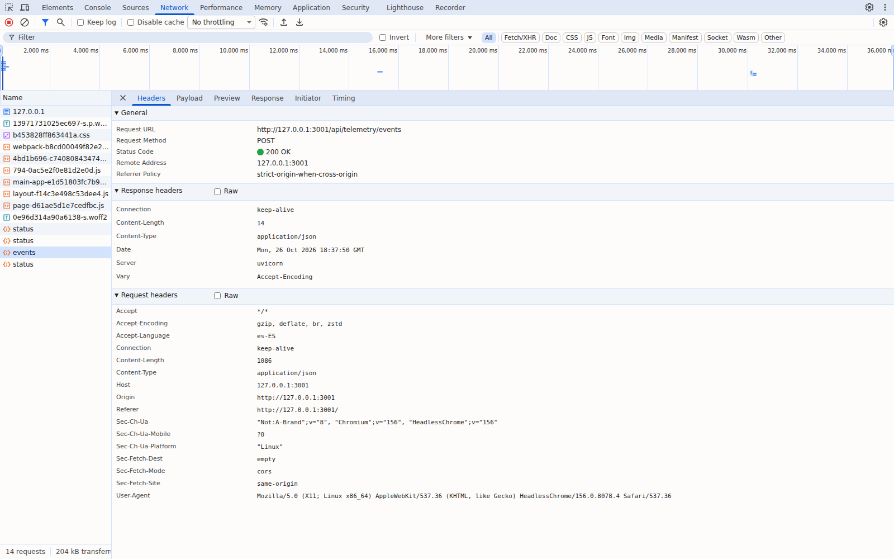
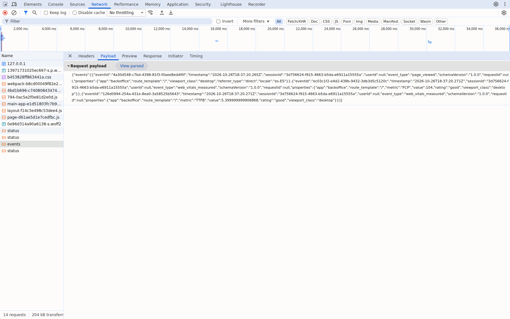
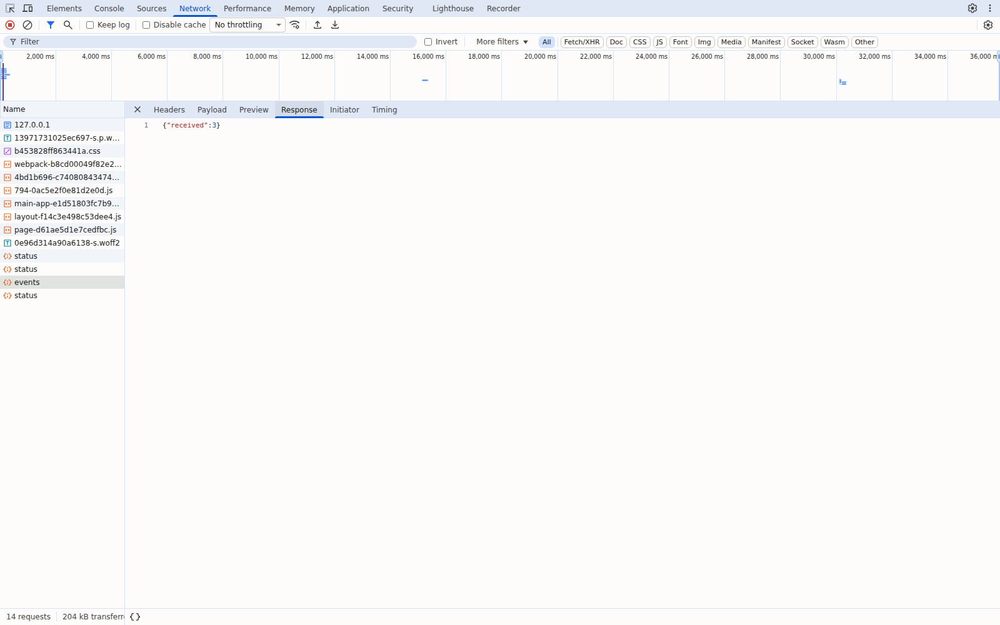

# Captura de telemetría en el frontend

Implementa en la backoffice la captura definida en [`telemetry-plan.md`](./telemetry-plan.md) y el contrato [`event-schemas.json`](./event-schemas.json), sin cambiar nombres, propiedades ni envelope.

> **Bloqueo vigente:** `empresa-BRIEFING.md` sigue sin existir. Las métricas obligatorias no están verificadas y nada de esta captura implica su aprobación.

## Flujo

`track()` → cola en memoria → `POST /api/telemetry/events` (rewrite de Next.js, mismo origen y sin CORS) → FastAPI `POST /telemetry/events`.

| Pieza | Ubicación | Comportamiento |
|---|---|---|
| Cliente | `uis/backoffice/src/services/telemetry.ts` | API pública: `track(eventType, properties, { requestId? })`. Genera `eventId` (UUID v4), `timestamp` ISO UTC, `sessionId` (rota tras 30 min inactivo), `schemaVersion` `1.0.0`; `userId` siempre `null` (no hay Auth). Flush cada 30 s o al llegar a 20 eventos; `sendBeacon` al ocultar/cerrar la página (incluye lotes pendientes de reintento). Reintentos con backoff de 1, 2 y 4 s (máximo 3) solo ante red, 5xx o 429; un 4xx no se reintenta. Nunca lanza ni bloquea la UI. |
| Configuración | `uis/backoffice/.env.example` → `.env.local` | `NEXT_PUBLIC_TELEMETRY_ENDPOINT=/api/telemetry/events` (también es el valor por defecto). |
| API | `services/api/app/routers/telemetry.py`, `app/schemas/telemetry.py` | Recibe `{ "events": [...] }` (máx. 100) y devuelve `200 {"received": N}`. Valida con Pydantic modelos generados desde una copia del contrato (`app/schemas/event-schemas.json`, idéntica a la de `docs/` por test): unión discriminada por `event_type`, `extra="forbid"`, tipos estrictos y `eventId` únicos en el lote. Un evento inválido produce `422` para todo el lote y no se registra nada. No hay almacén: los eventos aceptados solo se escriben en el log `trackflow.telemetry`. |

## Eventos instrumentados (3 de 39)

| `event_type` | Categoría | Componente / hook | Disparador real | Propiedades enviadas |
|---|---|---|---|---|
| `page_viewed` | Navegación | `app/telemetry-reporter.tsx` (`useEffect`, montado en `app/layout.tsx`) | Primera carga de la ruta `/` (protegido contra el doble efecto de Strict Mode) | `app`, `route_template`, `viewport_class`, `referrer_type`, `locale` (solo si cumple el patrón) |
| `frontend_error_occurred` | Errores | `app/telemetry-reporter.tsx` (`window` `error` / `unhandledrejection`) y `app/backend-status.tsx` | Excepción JS o promesa rechazada; fallo de `/api/status` (solo en la transición a fallo, no en cada sondeo de 15 s) | `app`, `route_template`, `error_kind`, `error_fingerprint` (FNV-1a de 64 bits; nunca mensaje ni stack), `http_status` |
| `web_vitals_measured` | Rendimiento | `app/telemetry-reporter.tsx` (`useReportWebVitals` de Next.js, sin dependencias nuevas) | Next.js reporta LCP, CLS, INP, TTFB o FCP | `app`, `route_template`, `metric`, `value`, `rating`, `viewport_class` |

`route_template` solo toma `/` o `<unmatched>`; nunca se envían la URL, la query ni el referrer. El `fetch_failed` lleva como `requestId` el mismo UUID que se envía en `X-Request-Id` a `/api/status`.

## Eventos pendientes (36) y motivo

| Eventos | Motivo |
|---|---|
| `cta_clicked` | Sus CTA pertenecen al website; el módulo solo existe en la backoffice. Compartirlo exige decidir entre `packages/shared` o duplicarlo. |
| `dashboard_viewed` | La backoffice es una vista de contexto estática; `GET /dashboard/executive` devuelve 501. Medirlo sería simular un dashboard. |
| `carrier_selected`, `customer_satisfaction_submitted` | Su origen es frontend, pero no existe ni la UI ni el flujo. |
| `api_request_completed`, `api_request_failed`, `service_status_changed` | Disponibles hoy, pero el origen es el backend (middleware y `/status`); quedan fuera del alcance de captura frontend. |
| `inventory_movement_recorded`, `inventory_movement_rejected`, `inventory_stock_low_detected`, `inventory_items_viewed`, `inventory_seed_executed` | Demo local de backend o job; ningún componente de la UI ejecuta esos flujos. |
| `order_*`, `shipment_*`, `carrier_recommendation_requested`, `return_*`, `customer_health_scored`, `customer_contract_alert_triggered`, `support_ticket_*`, `auth_*`, `inventory_discrepancy_detected`, `integration_call_failed`, `report_weekly_generated`, `backup_completed` | Endpoints stub 501 o funcionalidades futuras. No se simulan órdenes, login, envíos ni inventario. |

## Verificación

| Comprobación | Resultado |
|---|---|
| `uv run --frozen --extra dev pytest -q` (`services/api`) | 148 passed (122 previos + 26 de `tests/test_telemetry.py`: lotes válidos, vacío, 13 eventos inválidos, restricciones numéricas, 5 formas de lote inválidas, cuerpo no JSON, paridad con el contrato) |
| `npm test` (`uis/backoffice`, `node:test`) | 7 passed: envelope, flush a 20 y a 30 s, backoff 1/2/4 s con máximo 3 reintentos y mismo `eventId`, sin reintento en 4xx, `sendBeacon` sin reenvíos, fallback a `fetch`, rotación de sesión. Si se fuerzan 4 reintentos o un backoff fijo, los tests fallan. |
| `npm run typecheck` / `npm run build` | PASS (`next build` carga `.env.local`) |
| Navegador real (Chromium 156 headless, `next start` + Uvicorn) | Ver abajo |

**Ejecución en navegador** ([`evidence/browser-run.json`](./evidence/browser-run.json), log de la API en [`evidence/api-accepted-events.jsonl`](./evidence/api-accepted-events.jsonl)):

1. Flush a los 30 s: el primer POST recibe un **503 inyectado** en la prueba; a 1 s se reintenta con los **mismos 3 `eventId`** → `200 {"received":3}`.
2. **Caída real de la API**: `/api/status` → 500 en el proxy → un `fetch_failed` con `http_status: 500` y `requestId` igual al `X-Request-Id` de esa petición; tras reiniciar la API → `200 {"received":1}`.
3. Error JS y promesa rechazada con email, número y `token=secret` en el mensaje; al ocultar la página, `sendBeacon` (tipo `ping`) → `200 {"received":3}`. Al cerrarla, el LCP llegó por un segundo beacon que la API registró y Playwright ya no pudo capturar.
4. Resultado: 8 eventos aceptados por la API, todos distintos; ningún `eventId` duplicado entre respuestas 200; 0 errores con `jsonschema` contra `event-schemas.json`; ni `@`, ni `probe`, ni `secret`, ni `token=`, ni `12345` ni URLs en los lotes; `userId` siempre `null`.

**DevTools (panel Network real de Chromium inspeccionando la pestaña de la backoffice):**

| Headers: `POST /api/telemetry/events` → 200 OK | Payload: lote `events[]` | Response |
|---|---|---|
|  |  |  |

## Limitaciones

- No hay persistencia ni deduplicación entre lotes en el servidor: se rechazan los duplicados dentro de un lote; la deduplicación por `eventId` del plan necesita un almacén que no existe.
- El backend no adopta todavía `X-Request-Id`: la correlación frontend/backend queda pendiente en el middleware.
- Los eventos son de `stream` y `batch` en el plan, pero el cliente usa un único transporte por lotes; no hay ruta `stream` separada.
- INP solo se emite tras una interacción del usuario; en la prueba automatizada no hubo ninguna.
- `next build` avisa de una vulnerabilidad conocida en Next.js 16.4.0; no se actualiza en esta rama.
