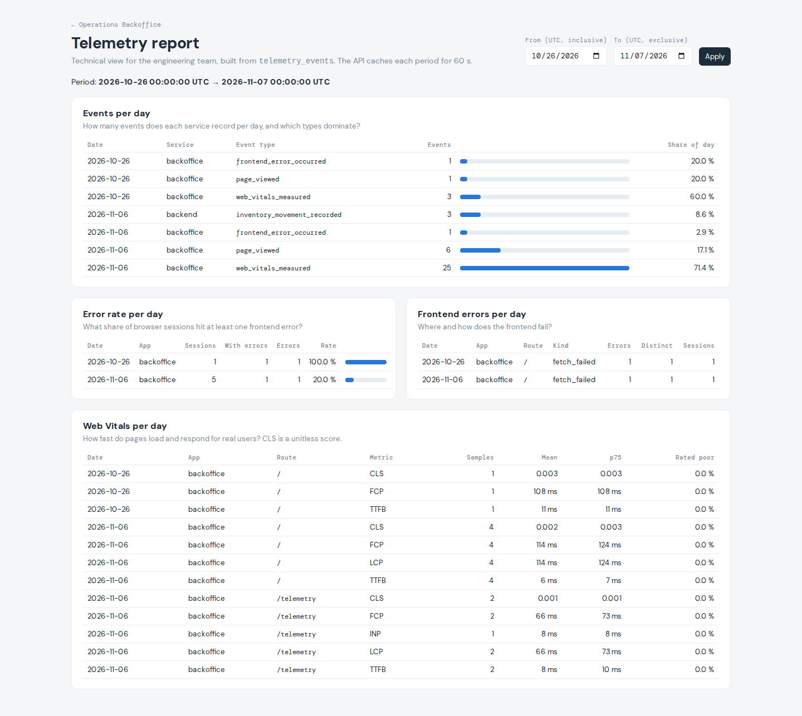

# Reporte técnico de telemetría

`GET /telemetry/report` devuelve métricas operacionales calculadas con pandas a partir de `public.telemetry_events`. Es un radar técnico para el equipo de ingeniería: volumen de eventos, errores del frontend y latencia percibida. No incluye métricas de negocio (ventas, conversión, ingresos), que llegarán con los pipelines de datos.

**Bloqueo que se mantiene:** `empresa-BRIEFING.md` sigue sin existir. Las métricas se han elegido a partir del catálogo de [`telemetry-plan.md`](./telemetry-plan.md) y de los eventos que se emiten de verdad hoy.

## Dónde está cada pieza

| Pieza | Ruta |
|---|---|
| Pipeline de análisis | [`services/api/app/telemetry/analysis.py`](../../services/api/app/telemetry/analysis.py) |
| Endpoint y caché | [`services/api/app/routers/telemetry.py`](../../services/api/app/routers/telemetry.py) |
| Modelos de respuesta | [`services/api/app/schemas/telemetry.py`](../../services/api/app/schemas/telemetry.py) (`TelemetryReport`) |
| Rol de lectura | [`services/api/supabase/migrations/20261106183444_create_telemetry_reader.sql`](../../services/api/supabase/migrations/20261106183444_create_telemetry_reader.sql) |
| Dashboard | [`uis/backoffice/app/telemetry/`](../../uis/backoffice/app/telemetry/) |

El enunciado pide `services/telemetry/analysis.py`. En este monorepo el backend vive en `services/api/` y el contenedor solo monta esa carpeta (`./services/api:/app`), así que el pipeline va en `services/api/app/telemetry/analysis.py`, el equivalente dentro de la API. De este modo no hay que tocar Docker ni Compose.

## Métricas

Hoy solo se emiten `page_viewed`, `web_vitals_measured` y `frontend_error_occurred` (backoffice) e `inventory_movement_recorded` (backend). Las métricas usan esos eventos; ninguna se basa en eventos que todavía no existen.

| Clave | Pregunta operacional | Eventos cargados en SQL | Dimensión | Agregación |
|---|---|---|---|---|
| `events_per_day` | ¿Cuántos eventos registra cada servicio al día y qué tipos dominan? | Todos los del periodo | día UTC × `service` × `event_type` | `size()` → `events`; `share` = `events` / total del día |
| `error_rate_per_day` | ¿Qué proporción de sesiones de navegador sufre al menos un error de frontend cada día? | `page_viewed`, `frontend_error_occurred` (una sola consulta) | día UTC × `app` | Por sesión: `any` y `sum` de `is_error`; por día: `sessions`, `sessions_with_errors`, `errors` y `error_rate` = `sessions_with_errors / sessions` |
| `frontend_errors_per_day` | ¿Dónde y cómo falla el frontend? | `frontend_error_occurred` | día UTC × `app` × `route_template` × `error_kind` | `errors` (`size`), `distinct_errors` (`nunique` del fingerprint), `sessions` (`nunique`) |
| `web_vitals_per_day` | ¿Cómo de rápido cargan y responden las páginas para usuarios reales? | `web_vitals_measured` | día UTC × `app` × `route_template` × `metric` | `samples`, `mean`, `p75` (`quantile(0.75)`, el percentil de referencia de Web Vitals) y `poor_rate` (`mean` de `rating == "poor"`). `unit` es `ms`, salvo CLS (`score`, sin unidad) |

- El ejemplo del enunciado usa `error_rate_by_type`. En nuestro catálogo los errores son un tipo de evento propio (`frontend_error_occurred`) y no un atributo de cada evento, así que la tasa se calcula por sesión, día y app. El detalle por tipo de error está en `frontend_errors_per_day`.
- Una sesión que sigue activa al cruzar la medianoche UTC cuenta en los dos días.
- La latencia es la percibida en el navegador (TTFB, FCP, LCP, INP y CLS). La latencia y los errores de la propia API (`api_request_completed` y `api_request_failed`) no se emiten todavía; lo dejamos fuera de esta fase.
- La métrica opcional de autenticación (`auth_failure_rate`) no está implementada: `POST /auth/login` sigue siendo un stub 501 y no existe ningún evento `auth_login_*` real.

## Pipeline

Cada función de métrica sigue el mismo orden: **cargar (SQL) → refinar (pandas) → convertir tipos → agrupar → agregar → servir**.

1. **Cargar.** `load_events(columns, start, end, event_types)` pide solo las columnas que usa la métrica, con `"timestamp" >= start and "timestamp" < end` (inicio inclusivo, fin exclusivo) y `event_type = any(...)` cuando la métrica no necesita todos los tipos. Nunca lee la tabla entera, y el endpoint limita el periodo a 90 días.
2. **Refinar.** `_extract` convierte las claves de `tags` en columnas sin bucles (`pd.DataFrame(df["tags"].tolist(), columns=...)`). Después se descartan las filas sin la dimensión (`dropna`). Se segmenta por todos los valores, sin prefiltrar.
3. **Convertir tipos.** `pd.to_datetime(df["timestamp"], utc=True, format="ISO8601")` y luego `.dt.date`. psycopg devuelve los `timestamptz` en la zona horaria de la sesión de Postgres y otras fuentes los dan como texto con offset; sin pasar a UTC, un evento cerca de medianoche cae en otro día sin que salte ningún error. Los tests lo comprueban con texto en `+01:00` y con una sesión real en `America/Los_Angeles`.
4. **Agrupar y agregar.** Solo `groupby`, `agg`, `size`, `nunique`, `mean`, `quantile` y `transform`. Un test analiza el código de cada función con `ast` y falla si encuentra un `for`, un `while` o una comprensión.
5. **Servir.** `.reset_index()`, orden estable y `to_dict(orient="records")` con la fecha en ISO (`"2026-11-06"`): listas de dicts que `json.dumps` serializa sin conversiones.

Las funciones no tienen efectos secundarios: con el mismo periodo y las mismas filas devuelven siempre lo mismo. `build_report(start, end)` las llama con el mismo periodo y monta `{"period": {...}, "metrics": {...}}`.

## Endpoint

```http
GET /telemetry/report?start_date=2026-10-26T00:00:00Z&end_date=2026-11-07T00:00:00Z
```

- `start_date` y `end_date` son opcionales y van en ISO 8601. Sin offset se interpretan como UTC (también vale solo la fecha, `2026-10-26`). Por defecto, `end_date` = ahora (UTC, al segundo) y `start_date` = `end_date − 7 días`. Si solo llega `start_date`, el fin es ahora; si solo llega `end_date`, el inicio son 7 días antes.
- El endpoint resuelve el periodo una vez y se lo pasa a cada métrica. Ninguna función aplica su propia ventana por defecto.
- `422` si `start_date >= end_date`, si el periodo supera 90 días o si una fecha no es ISO 8601. Ninguno de esos casos ejecuta el pipeline.
- `503 {"detail": "Telemetry report unavailable"}` si falta `TELEMETRY_READ_DATABASE_DSN` o la base de datos falla. El error no se guarda en caché.
- Respuesta: `{"period": {"from": "...Z", "to": "...Z"}, "metrics": {"events_per_day": [...], "error_rate_per_day": [...], "frontend_errors_per_day": [...], "web_vitals_per_day": [...]}}`, validada con `TelemetryReport`.

**Caché.** Reutilizamos el `TTLCache` en memoria del inventario con un TTL de 60 s. La clave es la combinación `start_date`/`end_date` recibida, normalizada a UTC (un parámetro omitido cuenta como `None`): `2026-10-26T01:00:00+01:00` y `2026-10-26T00:00:00Z` comparten entrada. Las peticiones sin parámetros también se cachean, y durante esos 60 s devuelven el periodo calculado en la primera.

## Acceso de lectura

`telemetry_writer` solo puede insertar, así que la migración `20261106183444_create_telemetry_reader.sql` añade el rol de grupo `telemetry_reader` (`NOLOGIN`) con `SELECT` sobre `public.telemetry_events` y la política `telemetry_reader_select` (`FOR SELECT`), necesaria porque RLS está forzado. Nada más cambia: el rol de escritura sigue sin poder leer y `anon`, `authenticated` y `service_role` siguen sin acceso.

La API lee con `TELEMETRY_READ_DATABASE_DSN`, una variable distinta de la de escritura, con un rol de login de cada entorno que pertenece a `telemetry_reader`. Ese rol y su contraseña no van en el repositorio. Pasos en [`services/api/README.md`](../../services/api/README.md#telemetry-report).

La migración se aplicó en el Supabase local con `supabase migration up --local` y no con `db reset`, para conservar los eventos ya guardados. En la base `telemetry_test` se aplicó con `psql`.

## Dashboard

`/telemetry` en el backoffice ([`app/telemetry/`](../../uis/backoffice/app/telemetry/)) pide `/api/telemetry/report` desde el navegador, igual que `BackendStatus` con `/api/status`, y muestra:

- el periodo `from → to` en UTC, con dos campos de fecha (inicio inclusivo, fin exclusivo) para cambiarlo;
- una tabla por métrica, con una barra de un solo tono para el volumen y la tasa de error; los valores siempre aparecen como texto.

No añade dependencias. La barra lateral del dashboard principal enlaza con la página, y `routeTemplate` ahora reconoce `/telemetry`, así que los eventos de esa página no salen como `<unmatched>`.



## Datos reales

Al empezar la tabla tenía 8 filas: 5 eventos técnicos del 2026-10-26 y 3 `inventory_movement_recorded` de hoy. Para pasar de 20 filas con variedad de tipos generamos actividad real en el backoffice con un script de Playwright 1.64.0 (Chromium 156, headless). La API corría con Uvicorn y los roles de login temporales con `telemetry_writer` y `telemetry_reader`, y el backoffice con `next start`:

- cinco sesiones de navegador en escritorio, móvil y tableta sobre `/` y `/telemetry`;
- en una de ellas el script paró la API de verdad. El sondeo de `/api/status` recibió un 500 del proxy y la página registró un `frontend_error_occurred` (`fetch_failed`, `http_status` 500). Con la API levantada de nuevo, el lote se guardó: `{"received":4,"stored":4,"rejected":0}`.

Tras esa actividad había 40 filas, y 46 después de la sesión de la captura: 8 `page_viewed`, 33 `web_vitals_measured`, 2 `frontend_error_occurred` y 3 `inventory_movement_recorded`, repartidas en dos días. Registro completo, log de la API y conteo final en [`evidence/report-checks.txt`](./evidence/report-checks.txt).

Muestras devueltas por el endpoint con estos datos:

- [`evidence/report-2026-10-26.json`](./evidence/report-2026-10-26.json): `start_date=2026-10-26T00:00:00Z&end_date=2026-11-07T00:00:00Z`, con los dos días;
- [`evidence/report-default.json`](./evidence/report-default.json): sin parámetros, los últimos 7 días, que solo incluyen el 2026-11-06.

## Verificación

| Comprobación | Resultado |
|---|---|
| `uv run --frozen --extra dev pytest -q` con `TELEMETRY_TEST_DATABASE_DSN`, `TELEMETRY_TEST_READER_DSN` y `TELEMETRY_TEST_ADMIN_DSN` | **224 passed** |
| Mismo comando sin esas variables | 194 passed, 30 skipped (los de integración) |
| `tests/test_telemetry_report.py` (28) | Carga por métrica (columnas, tipos y periodo), agrupación por día UTC con offsets y con datetimes en otra zona, cada métrica con valores esperados, filas sin dimensión descartadas, resultado repetible y serializable, periodo vacío, ausencia de bucles (`ast`), periodo por defecto de 7 días, solo inicio o solo fin, fechas sin offset y con offset, caché de 60 s (acierto, otra notación del mismo instante, otra combinación, caducidad y periodo por defecto), 422 sin ejecutar el pipeline y 503 que no se cachea |
| `tests/test_telemetry_report_storage.py` (9, Supabase local) | Inicio inclusivo y fin exclusivo al milisegundo, `tags` JSONB en cada métrica, fecha UTC con la sesión de Postgres en `America/Los_Angeles`, endpoint sobre la base real, `telemetry_reader` sin INSERT/UPDATE/DELETE/TRUNCATE y políticas de la tabla |
| Mutaciones manuales | Si se agrupa por el texto del timestamp o se quita `utc=True`, los tests de agrupación fallan (el 5 de noviembre pasa de 3 sesiones a 2; el evento de Los Ángeles cae el día anterior) |
| `supabase db lint --local --schema public` | Sin errores |
| `npm test`, `npm run typecheck`, `npm run build` (backoffice) | 7 passed; PASS; PASS con las rutas `/` y `/telemetry` |

Caché comprobada contra la API real (duración que registra el middleware):

| Petición | Duración |
|---|---|
| Periodo nuevo | 90,8 ms |
| El mismo periodo justo después | 1,2 ms |
| El mismo instante escrito con `+01:00` | 1,1 ms |
| El mismo periodo pasados 61 s | 427,6 ms (recalculado) |

## Limitaciones

- **Ubicación:** el pipeline está en `services/api/app/telemetry/` y no en `services/telemetry/` (ver arriba).
- **Latencia de la API:** no se mide hasta que el middleware emita `api_request_completed` y `api_request_failed`.
- **Autenticación:** no hay métrica de fallos de login porque `/auth/login` es un stub 501.
- **Histórico:** solo hay datos de dos días (2026-10-26 y 2026-11-06). La dimensión temporal existe, pero el periodo por defecto solo muestra un día.
- **Caché:** vive en memoria de cada proceso. `TTLCache` calcula con un lock, así que mientras se calcula un periodo, la petición de otro espera aunque su resultado ya esté en caché. En la evidencia se ve: el dashboard pidió dos periodos a la vez y el segundo tardó unos 400 ms.
- **Conexiones:** cada métrica abre su propia conexión (cuatro por cálculo, como mucho uno por periodo y minuto), sin pool.
- **Compose:** `docker-compose.yml` no pasa `TELEMETRY_READ_DATABASE_DSN` (tampoco la DSN de escritura), así que con ese stack el endpoint responde 503.
- **Supabase remoto:** la migración solo está aplicada en local, por el mismo motivo que en [`storage.md`](./storage.md#limitaciones).
